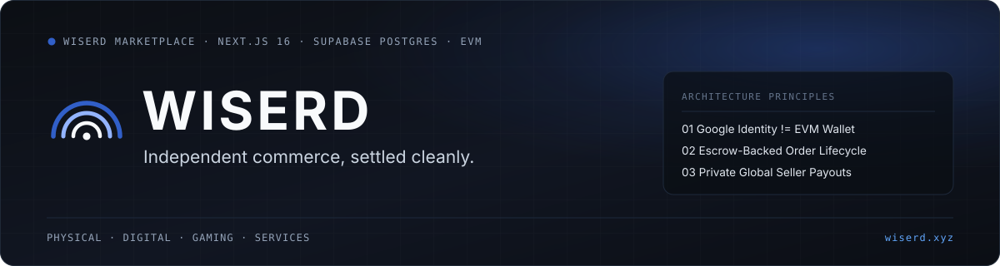
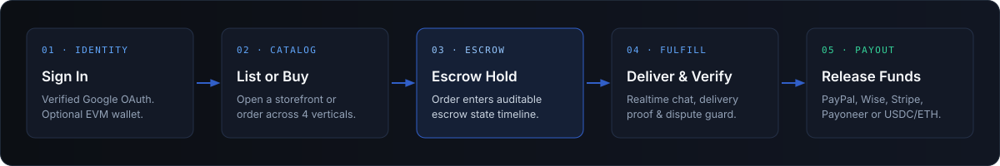

<p align="center">
  
</p>

<p align="center">
  
  
  
  
  
</p>

<p align="center">
  <b>WISERD</b> is an independent multi-category marketplace &amp; creator commerce platform.<br>
  Buyers and sellers trade physical goods, digital tools, gaming gear, and studio services with separated Google identity, escrow-tracked orders, and private global payouts.
</p>

<p align="center">
  <a href="#why">Why</a> ·
  <a href="#how-it-works">How it works</a> ·
  <a href="#architecture-guarantees">Architecture</a> ·
  <a href="#seller-payouts">Payouts</a> ·
  <a href="#repository">Repository</a> ·
  <a href="DEPLOY.md">Deploy guide</a> ·
  <a href="#security">Security</a>
</p>

---

## Why

Independent commerce breaks when identity, checkout, and trust are bolted together loosely. **WISERD** separates account identity from wallet settlement, tracks every order through an explicit escrow state machine, and keeps seller payout destinations strictly private on the server.

## How it works

<p align="center">
  
</p>

| Step | What happens |
| --- | --- |
| **01 · Sign In** | Users authenticate via server-verified **Google Identity Services (OAuth 2.0)**. Connecting an EVM wallet (MetaMask, Rainbow, WalletConnect) is optional and never replaces account identity. |
| **02 · List or Buy** | Sellers open an independent storefront in `/sell` across four verticals (`physical`, `digital`, `gaming`, `services`). Buyers discover listings via instant `Cmd/Ctrl + K` search and category filters. |
| **03 · Escrow Hold** | Checkout creates a stock-validated order tracked by an auditable escrow timeline from funding through fulfillment. |
| **04 · Deliver & Verify** | Buyers and sellers coordinate in real-time messaging (`/messages` via Supabase Realtime) with delivery confirmation and dispute protection. |
| **05 · Release Funds** | Upon confirmation (or idempotent admin dispute resolution), settlement routes to the seller's configured international payout rail. |

## Architecture guarantees

Every boundary is enforced server-side across API routes and database policies.

| Guarantee | Enforcement |
| --- | --- |
| **Separated identity & settlement** | Google OAuth sessions use HMAC-signed HTTP-only cookies (`WISERD_SESSION_SECRET`); wallet signatures (`viem`) bind optionally as a secondary settlement address. |
| **Private seller payout routing** | `payoutDestination` is validated server-side and stripped from all public `/api/stores` and storefront payloads. |
| **Clean day-1 production boot** | Production defaults to `WISERD_SEED_DEMO=false` so live launches start with `0` demo products and `0` demo stores. |
| **RLS-hardened Postgres + Realtime** | `supabase/INSTALL_WISERD_SUPABASE.sql` locks `wiserd_app_state` to `service_role`, enables Realtime on messages, and serves catalog media via public `wiserd-media` Storage CDN. |
| **Founder-scoped operations** | `/admin` requires verified emails in `WISERD_ADMIN_EMAILS`, sends `noindex` headers, and guards destructive actions with idempotency and two-step confirmation. |

### Public & health endpoints

```http
GET /api/health
GET /api/auth/session
GET /api/products
GET /api/stores
GET /sitemap.xml
```

## Seller payouts

Store owners configure one active international payout destination in `/sell`:

| Rail | Validation |
| --- | --- |
| **PayPal** | Valid email address |
| **Wise** | Valid email or Wise handle |
| **Stripe Connect** | Connected account reference (`acct_...`) or verified email |
| **Payoneer** | Valid account email |
| **Crypto Wallet (USDC / ETH)** | Checksummed EVM address (`0x...`) matching verified wallet rules |

## Repository

| Folder | What it is |
| --- | --- |
| [`src/app/`](src/app) | Next.js 16 App Router pages (`/marketplace`, `/sell`, `/orders`, `/messages`, `/community`, `/admin`, `/privacy`, `/terms`) and REST API route handlers. |
| [`src/components/`](src/components) | Editorial UI primitives, Google & EVM wallet modals, storefront/product views, escrow timeline, and GSAP motion components. |
| [`src/lib/`](src/lib) | HMAC session auth, Supabase Postgres + serverless-safe DB layer, commerce rules, integrations, and TypeScript types. |
| [`contracts/`](contracts) | Solidity commerce router and enterprise currency contracts (`WiserdCommerceRouter.sol`, `WiserdEnterpriseCurrency.sol`). |
| [`supabase/`](supabase) | Incremental SQL migrations (`001`–`006`) and unified [`INSTALL_WISERD_SUPABASE.sql`](supabase/INSTALL_WISERD_SUPABASE.sql). |
| [`scripts/`](scripts) | Automated verification & security suite (`verify-wiserd.mjs`, `verify-engine.mjs`). |
| [`DEPLOY.md`](DEPLOY.md) | Step-by-step production launch guide for Netlify / Vercel, Google OAuth, and Supabase. |

### Built with

Next.js 16 · React 19 · TypeScript 5 · Tailwind CSS 4 · Base UI · GSAP · Lucide · Supabase Postgres &amp; Realtime · viem · Solidity

### Quick start &amp; verification

```bash
npm install
cp .env.example .env.local   # add Supabase, Google OAuth, and session secrets
npm run dev                  # start local server on http://localhost:3000
```

```bash
npm run lint                 # ESLint check
npm run build                # Next.js 16 production build
node scripts/verify-wiserd.mjs
```

## Security

- **Never commit `.env.local` or service-role keys.** `.gitignore` excludes all `.env*` files (except `.env.example`), local database files, and raster media.
- Rotate `SUPABASE_SERVICE_ROLE_KEY` and `WISERD_SESSION_SECRET` before wide public launch.
- Found a security issue? Report it privately via GitHub Security Advisories instead of a public issue.

<p align="center"><sub>Discover more. Shop independently.</sub></p>
